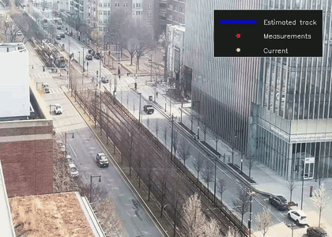
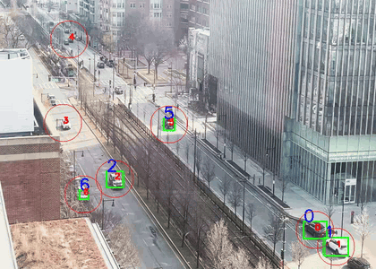

# Vehicle State Estimation and Tracking

A Python project for estimating vehicle motion and assigning persistent identities to objects detected in video. It includes single-object tracking with Alpha-Beta and Kalman filters, plus multi-object tracking with Kalman prediction and Hungarian data association.

## Project Highlights

- **Single-object tracking:** compare Alpha-Beta and Kalman-filter position estimates from per-frame measurements.
- **Multi-object tracking:** associate bounding-box detections across frames and maintain IDs for vehicles.
- **Visualization:** render filtered tracks and labeled detections over source video.
- **Data workflow:** read detections from JSON and save tracked results as JSON and video.

### Single-object tracking

| Kalman Filter                                                           | Alpha-Beta Filter                                                               |
| ----------------------------------------------------------------------- | ------------------------------------------------------------------------------- |
|  |  |

### Multi-object tracking

The multi-object example below shows detection boxes and assigned vehicle IDs over time.



## Tracking Methods

### Single vehicle

`single_vehicle_track.py` accepts measurements in `[x, y]` form and supports two filters:

- **Alpha-Beta:** constant-velocity prediction with fixed position and velocity correction gains.
- **Kalman:** uses a four-value state `[x, vx, y, vy]` and position observations `[x, y]`.

A missing measurement can be represented as `[-1, -1]` in the input data.

### Multiple vehicles

`multi_vehicle_tracker.py` reads per-frame bounding-box detections, initializes a track for each object in the first frame, predicts existing tracks with a Kalman filter, then uses global Hungarian assignment over center-to-center distances. Matches must be closer than the configured threshold; unmatched detections start new tracks and unmatched tracks continue from their predictions.

The threshold is a pixel distance in the coordinates of the resized 700 by 500 video frames. It may need adjustment for different videos or detector output.

## Setup

Use Python 3 and install the dependencies:

```bash
python -m pip install -r requirements.txt
```

## Run Single-Object Tracking

Run either filter with the included defaults:

```bash
python single_vehicle_track.py --filter-type alpha_beta
python single_vehicle_track.py --filter-type kalman
```

The script defaults to `data/object_to_track.json` and `data/commonwealth.mp4`. Choose alternate inputs or a video output path with:

```bash
python single_vehicle_track.py \
  --filter-type kalman \
  --track_path data/object_to_track.json \
  --video_path data/commonwealth.mp4 \
  --output_video results/single_vehicle_track.mp4
```

The input JSON contains an `obj` key whose value is a sequence of `[x, y]` measurements. The script writes the estimated positions to `data/single_vehicle_track.json`. If `--output_video` is omitted, it writes `results/<filter>_single_veh_track.mp4`.

## Run Multi-Object Tracking

Run the multi-object tracker using its default paths:

```bash
python multi_vehicle_tracker.py
```

The defaults are:

- Input detections: `data/frame_dict.json`
- Source video: `data/commonwealth.mp4`
- Tracked detections: `data/multi_vehicle_tracks.json`
- Annotated video: `results/multi_vehicle_tracking.mp4`
- Association threshold: 35 pixels

Override any of these values from the command line:

```bash
python multi_vehicle_tracker.py \
  --tracks_path data/frame_dict.json \
  --video_path data/commonwealth.mp4 \
  --output_tracks data/multi_vehicle_tracks.json \
  --output_video results/multi_vehicle_tracking.mp4 \
  --threshold 35
```

The input JSON is a mapping from consecutive stringified frame indices (`"0"`, `"1"`, ...) to lists of detections. Each detection must contain `x_min`, `y_min`, `width`, and `height`. The tracker adds an `id` field to each detection in the saved JSON.

## Project Files

- `single_vehicle_track.py` — single-object Alpha-Beta and Kalman tracking command-line program.
- `multi_vehicle_tracker.py` — multi-object Kalman tracking and Hungarian assignment command-line program.
- `kalman.py` — shared linear Kalman filter implementation.
- `utils.py` — JSON loading and drawing helpers for tracks, detections, and videos.
- `data/` — sample detection JSON, measurement JSON, and source video.
- `assets/` — animated GIF previews embedded in this README.
- `results/` — generated annotated videos and other example outputs.
- `part2_final.py`, `pa3_demo.py`, `Part2_final.ipynb`, and `multi_vehicle_tracker_old.py` — earlier assignment/demo implementations and experiments; the commands above use the current tracker scripts.

## Requirements

Dependencies are listed in `requirements.txt`: NumPy, OpenCV, SciPy, Matplotlib, and ContourPy. SciPy provides the Hungarian assignment routine used by multi-object tracking.
